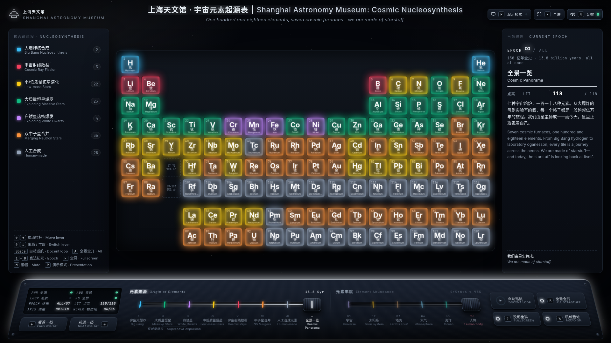
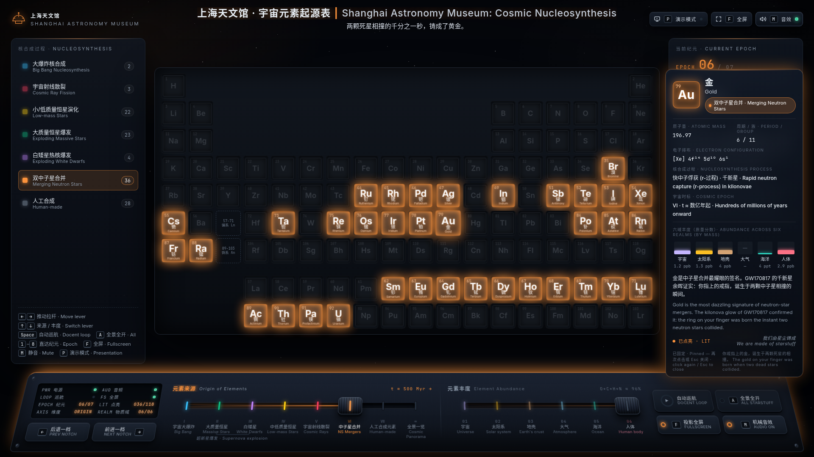
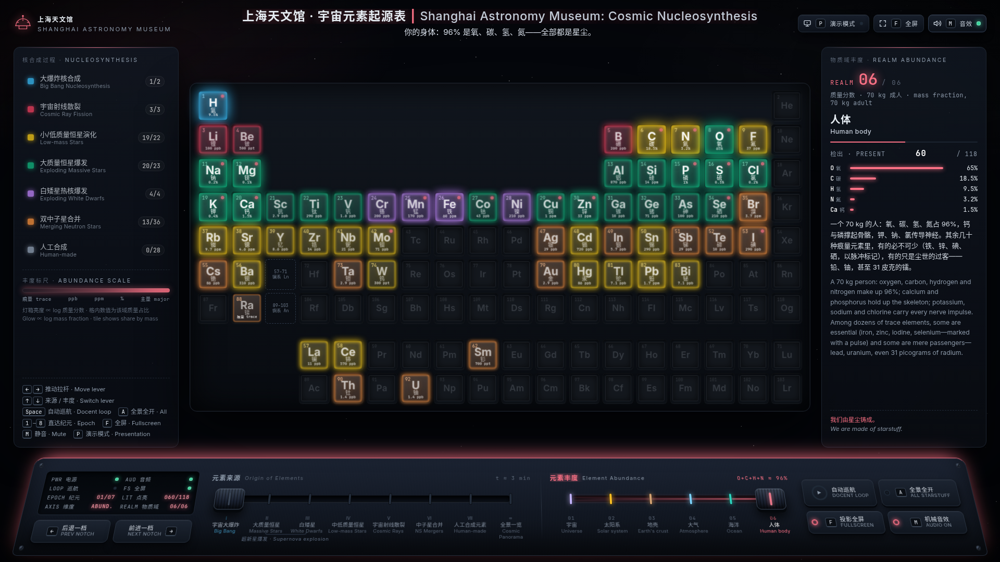
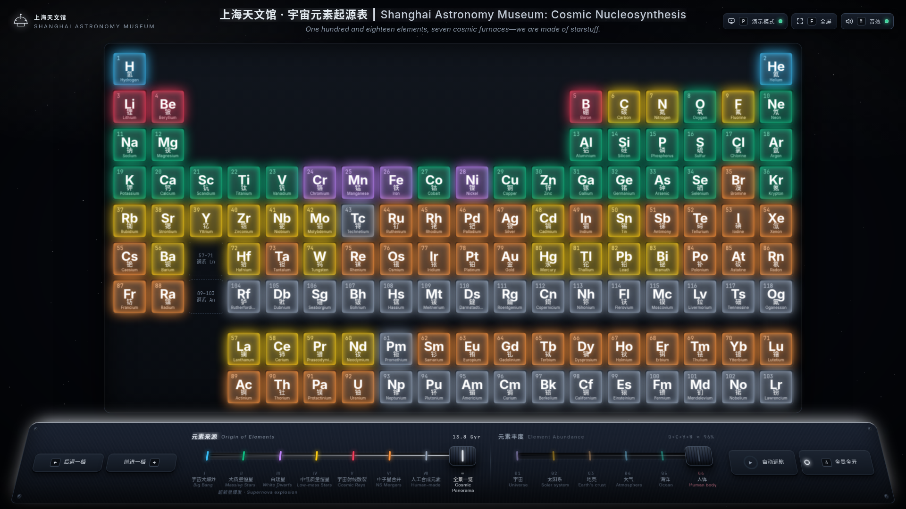

# 宇宙元素起源表 · Cosmic Origin of Elements

上海天文馆「宇宙元素起源表」互动展陈的网页复刻：一面 118 格的元素灯箱墙，两条机械拉杆，一个会呼吸的玻璃 HUD。
A web recreation of the Shanghai Astronomy Museum's *Cosmic Nucleosynthesis* exhibit: a 118-tile lightbox wall, two mechanical levers, and a glass telemetry HUD.

**在线演示 · Live demo:** <https://atschx.github.io/cosmic-elements-exhibit/>



## 它是什么 · What it is

- **单文件、零依赖** — 整个展项就是 [`docs/index.html`](docs/index.html)（约 170 KB），纯 HTML / CSS / JavaScript，没有任何外部请求；双击即可离线运行，也可直接托管在 GitHub Pages。
  **Single file, zero dependencies** — the whole exhibit is `docs/index.html`, plain HTML / CSS / JS with no network requests. Open it locally or host it on GitHub Pages as-is.
- **两条拉杆、两个维度** — 与馆内控制台一致：
  **Two levers, two axes**, as on the museum console:
  - **元素来源 · Origin of Elements** — 宇宙大爆炸 → 大质量恒星 → 白矮星 → 中低质量恒星 → 宇宙射线散裂 → 中子星合并 → 人工合成 → 全景一览；每一档点亮该核合成过程产出的元素（大爆炸只点亮 H、He）。
    Big Bang → massive stars → white dwarfs → low-mass stars → cosmic-ray spallation → neutron-star mergers → human-made → panorama; each notch lights the elements forged by that process.
  - **元素丰度 · Element Abundance** — 宇宙 / 太阳系 / 地壳 / 大气 / 海洋 / 人体；灯箱亮度 ∝ log 质量分数，格内直接显示占比。
    Universe / Solar System / Earth's crust / Atmosphere / Ocean / Human body; glow ∝ log mass fraction, with the share printed on each tile.
- **全 118 种元素，中英双语** — 每个元素都有来源分类、电子排布、六域丰度柱状图和一段叙事。
  **All 118 elements, bilingual** — origin category, electron configuration, six-realm abundance bars and a short narrative for every element.
- **程序化机械音效** — 纯 Web Audio 合成的拉杆咔哒、继电器点亮、舱室低鸣；首次交互后才解锁音频。
  **Procedural mechanical sound** — lever clacks, relay ticks and a stage hum synthesised with Web Audio, unlocked on first user gesture.
- **演示模式** — 一键收起两侧面板与状态屏，灯箱墙放大填满屏幕，适合投影。
  **Presentation mode** — collapses both side panels and the LCD so the wall fills the screen; made for projectors.

| 纪元态 · Epoch (NS mergers, Au pinned) | 丰度态 · Abundance (Human body) |
| --- | --- |
|  |  |



## 操作 · Controls

| 按键 · Key | 作用 · Action |
| --- | --- |
| `←` `→` | 推动当前拉杆 · Move the active lever |
| `↑` `↓` | 切换拉杆：来源 / 丰度 · Switch lever: origin / abundance |
| `1`–`8` | 直达纪元 · Jump to an epoch |
| `Space` | 自动巡航演播（9 s 倒计时环）· Docent loop |
| `A` | 全景全开 · All starstuff |
| `P` | 演示模式 · Presentation mode |
| `F` | 全屏 · Fullscreen |
| `M` | 静音 · Mute |
| `Esc` | 取消固定 / 停止巡航 · Unpin / stop loop |

鼠标：悬停格子显示 HUD，点击固定；拉杆支持拖拽与点击刻度。
Mouse: hover a tile for the HUD, click to pin; levers can be dragged or clicked at a notch.

## 部署到 GitHub Pages · Deploy

仓库自带 [`.github/workflows/pages.yml`](.github/workflows/pages.yml)。推送到 `main` 后，工作流会把 `docs/` 发布为站点。
The repo ships with a Pages workflow: every push to `main` publishes `docs/` as the site.

```bash
# 在仓库根目录 · from the repository root
git init -b main                                  # 如果还不是 git 仓库 · if not already a repo
git add .
git commit -m "Cosmic Origin of Elements exhibit"
git remote add origin https://github.com/<your-github-username>/<repo-name>.git
git push -u origin main
```

首次推送后，到 **Settings → Pages** 确认 *Source* 为 **GitHub Actions**（工作流会尝试自动启用；若仓库策略不允许，手动选一次即可）。几十秒后站点就会出现在 `https://<your-github-username>.github.io/<repo-name>/`。
After the first push, open **Settings → Pages** and make sure *Source* is **GitHub Actions** (the workflow tries to enable it automatically). The site appears at the URL above within a minute.

不想用 Actions？也可以选 *Deploy from a branch* → `main` / `/docs`，效果相同。
Prefer branch deploys? *Deploy from a branch* → `main` / `/docs` works too.

## 本地运行 · Run locally

直接用浏览器打开 `docs/index.html` 即可。Just open `docs/index.html` in a browser.

## 数据来源 · Data

- 元素来源分类参照馆内展板与 Johnson (2019) 的宇宙元素起源周期表；大爆炸核合成按馆内呈现只点亮 H 与 He，Li 归入宇宙射线散裂档并在叙事中说明其混合来源。
  Origin categories follow the museum panel and Johnson's (2019) *Origin of the Elements* table; Big Bang lights H and He only, as in the museum, with Li's mixed origin explained in the narrative.
- 丰度：太阳 / 宇宙取 Asplund et al. (2009) 光球丰度换算为质量分数；地壳与海水取 CRC Handbook；大气按干空气质量分数；人体按 70 kg 参考人。
  Abundances: Asplund et al. (2009) photospheric values converted to mass fraction (Sun / Universe), CRC Handbook (crust, seawater), dry-air mass fractions (atmosphere), 70 kg reference human.

## 目录 · Layout

```
docs/index.html   展项本体（GitHub Pages 站点根）· the exhibit, served as the site root
media/            截图 · screenshots used in this README
.github/workflows/pages.yml   Pages 部署工作流 · deployment workflow
```
