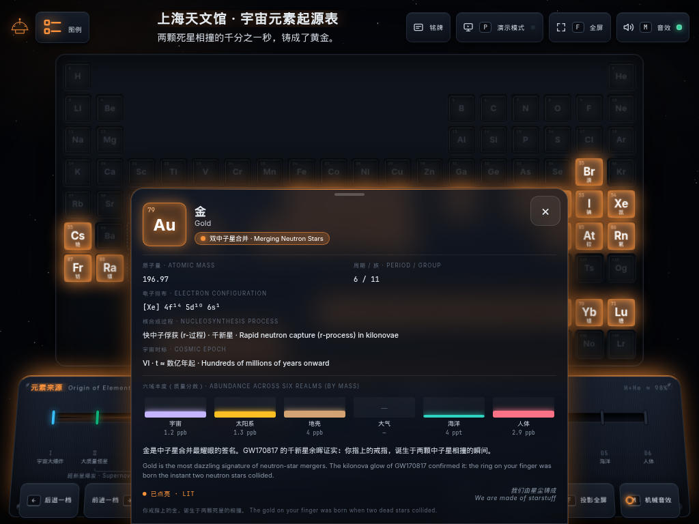
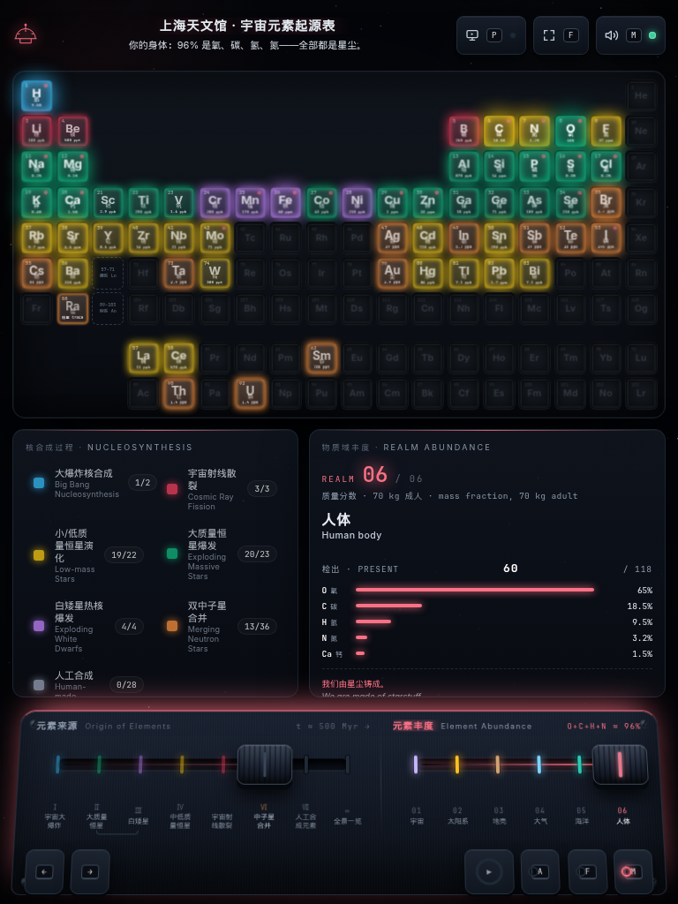
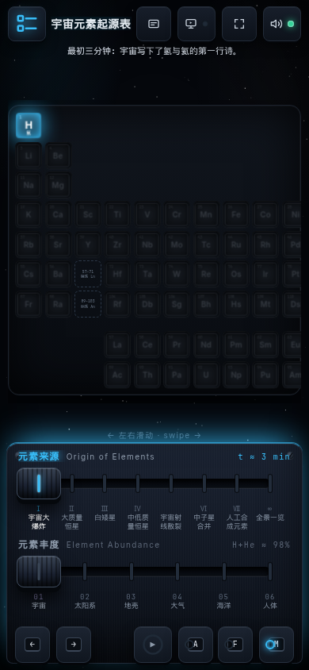
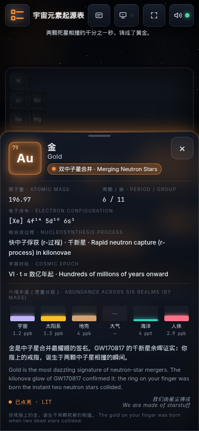

# 宇宙元素起源表 · Cosmic Origin of Elements

上海天文馆「宇宙元素起源表」互动展陈的网页复刻：一面 118 格的元素灯箱墙，两条机械拉杆，一个会呼吸的玻璃 HUD。
A web recreation of the Shanghai Astronomy Museum's _Cosmic Nucleosynthesis_ exhibit: a 118-tile lightbox wall, two mechanical levers, and a glass telemetry HUD.

**在线演示 · Live demo:** <https://atschx.github.io/cosmic-elements-exhibit/>


v2 把原来的单文件页面重构为 **Bun + React + TypeScript + Vite** 工程：数据与代码分离、组件化、可测试，并新增 **iPad / 手机触屏适配**。视觉与交互与 v1 一比一保持一致。
v2 rebuilds the former single-file page as a **Bun + React + TypeScript + Vite** project — data separated from code, componentised, tested — and adds **iPad / phone touch support**. Look and behaviour are kept 1:1 with v1.

## 它是什么 · What it is

- **两条拉杆、两个维度** — 与馆内控制台一致：
  **Two levers, two axes**, as on the museum console:
  - **元素来源 · Origin of Elements** — 宇宙大爆炸 → 大质量恒星 → 白矮星 → 中低质量恒星 → 宇宙射线散裂 → 中子星合并 → 人工合成 → 全景一览；每一档点亮该核合成过程产出的元素（大爆炸只点亮 H、He）。
    Big Bang → massive stars → white dwarfs → low-mass stars → cosmic-ray spallation → neutron-star mergers → human-made → panorama; each notch lights the elements forged by that process.
  - **元素丰度 · Element Abundance** — 宇宙 / 太阳系 / 地壳 / 大气 / 海洋 / 人体；灯箱亮度 ∝ log 质量分数，格内直接显示占比。
    Universe / Solar System / Earth's crust / Atmosphere / Ocean / Human body; glow ∝ log mass fraction, with the share printed on each tile.
- **全 118 种元素，中英双语** — 每个元素都有来源分类、电子排布、六域丰度柱状图和一段叙事。
  **All 118 elements, bilingual** — origin category, electron configuration, six-realm abundance bars and a short narrative for every element.
- **程序化机械音效** — 纯 Web Audio 合成的拉杆咔哒、继电器点亮、舱室低鸣；首次交互后才解锁音频。
  **Procedural mechanical sound** — lever clacks, relay ticks and a stage hum synthesised with Web Audio, unlocked on first user gesture.
- **演示模式** — 一键收起两侧面板与状态屏，灯箱墙放大填满屏幕，适合投影。
  **Presentation mode** — collapses both side panels and the LCD so the wall fills the screen; made for projectors.
- **两种构建产物** — 多文件静态站点（GitHub Pages）与**零外部请求的单个 HTML 文件**（离线 / U 盘 / 展厅一体机）。
  **Two build outputs** — a multi-file static site (GitHub Pages) and a **single self-contained HTML file with zero external requests** (offline, USB stick, kiosk).

| 纪元态 · Epoch (NS mergers, Au pinned) | 丰度态 · Abundance (Human body)            |
| -------------------------------------- | ------------------------------------------ |
|        |  |


## 操作 · Controls

| 按键 · Key   | 作用 · Action                                                     |
| ------------ | ----------------------------------------------------------------- |
| `←` `→`      | 推动当前拉杆 · Move the active lever                              |
| `↑` `↓`      | 切换拉杆：来源 / 丰度 · Switch lever: origin / abundance          |
| `1`–`8`      | 直达纪元 · Jump to an epoch                                       |
| `Home` `End` | 第一档 / 最后一档 · First / last notch                            |
| `Space`      | 自动巡航演播（9 s 倒计时环）· Docent loop                         |
| `A`          | 全景全开 · All starstuff                                          |
| `P`          | 演示模式 · Presentation mode                                      |
| `F`          | 全屏 · Fullscreen                                                 |
| `M`          | 静音 · Mute                                                       |
| `Esc`        | 关闭抽屉 / 取消固定 / 停止巡航 · Close drawer / unpin / stop loop |

鼠标：悬停格子显示 HUD，点击固定；拉杆支持拖拽与点击刻度。拉杆旋钮本身也是可用键盘操作的 `role="slider"`。
Mouse: hover a tile for the HUD, click to pin; levers can be dragged or clicked at a notch. Each knob is also a keyboard-operable `role="slider"`.

## 移动端 · Mobile & tablet

<table>
  <tr>
    <td></td>
    <td></td>
    <td></td>
    <td></td>
  </tr>
</table>

布局按视口自动切换为三种模式 · Three layout modes, chosen from the viewport:

| 模式 · Mode | 触发 · When                                | 布局 · Layout                                                                                   |
| ----------- | ------------------------------------------ | ----------------------------------------------------------------------------------------------- |
| **wide**    | > 1180 px（桌面、横屏大平板）              | 图例 / 铭牌分列灯箱墙两侧，与 v1 相同 · side panels flank the wall, as in v1                    |
| **stacked** | ≤ 1180 px 竖屏且高度 ≥ 860 px（iPad 竖屏） | 图例与铭牌并排放在灯箱墙下方 · legend + plaque sit in a row under the wall                      |
| **compact** | ≤ 1180 px 其余情况（iPad 横屏、手机）      | 面板收进抽屉，由标题栏的「图例」「铭牌」按钮唤出 · panels become drawers behind the header tabs |

触屏专属行为 · Touch behaviour:

- 拉杆支持**手指拖拽**、点击刻度与档位；旋钮 64 × 48 px，刻度命中区放大。
  Levers accept **touch drag** plus taps on notches and labels; knobs are 64 × 48 px with enlarged tick hit areas.
- HUD 不再依赖悬停：**点一下已点亮的格子**，遥测卡片从底部升起为可滚动的底部面板，右上角 44 px 关闭键，点击空白处亦可收起。
  The HUD no longer depends on hover: **tap a lit tile** and the telemetry card rises as a scrollable bottom sheet with a 44 px close key; tapping elsewhere dismisses it.
- 手机竖屏：标题栏两行、两条拉杆上下堆叠；灯箱格最小 34 px，墙面**横向滑动**并带「左右滑动 · swipe」提示。
  Phone portrait: two-row header, levers stacked; tiles never shrink below 34 px — the wall **scrolls sideways** with a swipe hint.
- 手机横屏（高度 ≤ 480 px）：页面改为纵向滚动，保证格子可读。
  Phone landscape (≤ 480 px tall): the page scrolls vertically so tiles stay legible.
- 所有按钮 ≥ 44 px；`:hover` 规则只在 `(hover: hover)` 下生效；使用 `100dvh` / `--vh` 与 `safe-area-inset-*` 适配浏览器工具栏与刘海。
  Every control is ≥ 44 px; `:hover` rules are gated behind `(hover: hover)`; `100dvh` / `--vh` and `safe-area-inset-*` handle browser chrome and notches.

## 开发 · Development

需要 [Bun](https://bun.sh) ≥ 1.2（同时作为运行时、包管理器、脚本与单元测试运行器）。
Requires [Bun](https://bun.sh) ≥ 1.2 — runtime, package manager, script and unit-test runner.

```bash
bun install                 # 安装依赖 · install dependencies
bun run dev                 # Vite 开发服务器 · dev server (http://localhost:5173)

bun run validate:data       # 校验 src/data/*.json · validate the exhibit data
bun run lint                # ESLint（typescript-eslint strict + react-hooks + jsx-a11y）
bun run typecheck           # tsc（app / node / e2e 三个项目）
bun run format              # Prettier 写回 · write;  format:check 只检查 · check only
bun run check               # validate:data + lint + typecheck + format:check
bun run test                # bun test — 数据模型与 schema 单元测试 · unit tests
bun run test:e2e            # Playwright 回归（系统 Chrome；自动起 preview 服务器）· e2e regression

bun run build               # → dist/         多文件站点，base=/cosmic-elements-exhibit/
bun run build:single        # → dist-single/index.html  单文件，零外部请求 · single file, zero requests
bun run preview             # 预览 dist/ · http://localhost:4173/cosmic-elements-exhibit/
bun run preview:single      # 预览 dist-single/ · http://localhost:4174/
```

### 两种构建产物 · The two build outputs

| 命令 · Command         | 输出 · Output            | 用途 · Use                                                                                                                         |
| ---------------------- | ------------------------ | ---------------------------------------------------------------------------------------------------------------------------------- |
| `bun run build`        | `dist/`                  | GitHub Pages 站点（`vite.config.ts` 中 `base: '/cosmic-elements-exhibit/'`）· the Pages site, JS/CSS split and hashed              |
| `bun run build:single` | `dist-single/index.html` | 单个 HTML，内联全部 JS / CSS / 图标，**没有任何外部请求**；双击即可离线运行 · one HTML file with everything inlined, works offline |

两者由同一份源码构建，`--mode single` 切换 `base: './'` 与 [`vite-plugin-singlefile`](https://github.com/richardtallent/vite-plugin-singlefile)。
Both come from the same source; `--mode single` flips `base` to `'./'` and enables `vite-plugin-singlefile`.

## 目录结构 · Project layout

```
index.html                    Vite 入口 · Vite entry (meta, viewport-fit=cover, data-URL favicon)
src/
  main.tsx                    挂载 + 全局样式层叠顺序 · mount + global stylesheet order
  App.tsx                     布局模式（wide / stacked / compact）与组件装配 · layout mode & composition
  data/                       ★ 展陈数据（纯 JSON）· exhibit data (plain JSON)
    elements.json             118 种元素：序号、符号、中英名、原子量、电子排布、格位、来源分类、双语叙事
    categories.json           7 个核合成过程（颜色、名称）· 7 nucleosynthesis processes
    stages.json               拉杆 8 档（含全景）· 8 lever notches incl. panorama
    domains.json              6 个丰度域及其数据来源 · 6 abundance realms + data source
    abundance/*.json          太阳 log ε 与地壳 / 大气 / 海洋 / 人体 ppm 表 · solar log ε and ppm tables
    essential.json            人体必需元素 · essential-for-life symbols
    types.ts · schema.ts      TS 类型与运行时校验器（应用与 validate:data 共用）· types + runtime parsers
  model/                      派生数据：丰度换算、点亮列表、格式化 · derived data (lit lists, fmtAb, lumOf…)
  state/                      轻量 store（useSyncExternalStore）+ selectors · lightweight store
  audio/                      Web Audio 机械音效引擎 + hook · procedural sound engine
  hooks/                      快捷键、媒体查询、全屏、--vh 同步 · shortcuts, media queries, fullscreen, --vh
  components/
    Marquee/                  标题栏、打字机副标题、顶部开关与抽屉按钮 · header, typewriter subtitle, toggles
    Legend/ · Plaque/         图例面板、纪元铭牌 · legend & epoch plaque panels
    LightboxWall/             灯箱墙 + 3D 翻面 Tile · the wall and its flipping tiles
    ConsoleDeck/              控制台：LCD、拉杆轨道、巡航键 · console deck, lever rails, auto key
    TelemetryHud/             元素遥测卡片（桌面悬浮 / 触屏底部面板）· HUD card (floating / bottom sheet)
    Drawer/                   紧凑布局的侧滑 / 底部抽屉 · side / bottom drawers for compact layouts
    Backdrop/ · PulseLayer/   星空画布、点火脉冲环 · starfield canvas, ignition pulse rings
  styles/
    tokens.css                设计变量、clamp() 字号梯度、--tile 尺寸公式 · design tokens, type ramp, tile size
    global.css                基础样式与 #app 三行网格 · base styles, app shell grid
    responsive.css            桌面分级（1600 / 1500 / 1180）与演示模式 · desktop tiers & presentation mode
    mobile.css                触屏与紧凑布局（≤1180 / ≤900 / ≤640 / 矮横屏）· touch & compact tiers
  publicApi.ts                window.CosmicExhibit（讲解员 / 测试用 API）· docent & test API
scripts/validate-data.ts      数据校验脚本 · data validator
tests/unit/                   bun test 单元测试 · unit tests
tests/e2e/                    Playwright 回归（桌面 ×3、单文件、iPad ×2、iPhone）· e2e regression
legacy/index.html             v1 单文件版本，仅作归档，不参与部署 · the v1 single file, archived, not deployed
.github/workflows/pages.yml   CI：校验 → lint/typecheck → 测试 → 构建 → 部署 dist/ + 上传单文件产物
```

## 修改数据 · Editing the data

所有展陈内容都在 `src/data/` 的 JSON 里，改完运行 `bun run validate:data` 即可：
All exhibit content lives in `src/data/*.json`; run `bun run validate:data` after editing:

- **元素文案** — `elements.json` 中每个元素的 `narrativeZh` / `narrativeEn`（HUD 与铭牌引用的叙事）、`config`（电子排布，`4f14 5d10 6s1` 写法会自动上标）。
  **Element copy** — `narrativeZh` / `narrativeEn` and `config` (electron configuration; `4f14 5d10 6s1` is rendered with superscripts).
- **来源分类** — 元素的 `originCategory` 必须是 `categories.json` 中的 `key`；图例计数与各档点亮数自动更新。
  **Origin category** — `originCategory` must be a key from `categories.json`; legend counts and lit counts follow.
- **丰度** — `abundance/*.json` 以符号为键：太阳系 / 宇宙用 log ε（由 `domains.json` 里的 X_H、He ppm 折算），其余为 ppm（质量）。
  **Abundances** — keyed by symbol: solar / universe as log ε (converted using X_H and He ppm from `domains.json`), the rest as ppm by mass.
- **校验规则** — 118 个元素、序号 / 符号 / 格位无重复、字段齐全、每个丰度域质量分数之和落在 99.8 – 100.3 %（地壳在 `domains.json` 中用 `sumRange` 放宽到 100.35 %，并以 `sumNote` 说明 CRC 数据逐项取整的来源）。
  **Validation** — 118 elements, no duplicate Z / symbol / grid cell, all fields present, every realm's mass fractions sum to 99.8 – 100.3 % (the crust widens this via `sumRange` to 100.35 % with a `sumNote` explaining the CRC rounding).

## 质量 · Quality

- TypeScript `strict` + `noUncheckedIndexedAccess` + `exactOptionalPropertyTypes`；ESLint flat config（typescript-eslint `strictTypeChecked`、react-hooks、jsx-a11y）；Prettier。
- 可访问性：格子、图例、刻度都是真正的 `<button>`；拉杆是 `role="slider"`（方向键 / Home / End）；HUD 为 `role="dialog"`；`:focus-visible` 样式；`prefers-reduced-motion` 降级。
  Accessibility: tiles, legend items and tick labels are real `<button>`s; levers are `role="slider"`; the HUD is a `role="dialog"`; focus-visible styling; reduced-motion fallback.
- Lighthouse（桌面，`dist/` 预览）：Performance 100 · Accessibility 100 · Best Practices 100 · SEO 100。
- Playwright 回归覆盖：118 格、8 档点亮数 2/23/4/22/3/36/28/118、6 域点亮数 83/83/90/12/62/60、全部快捷键、拉杆拖拽、HUD、演示模式、零控制台报错、单文件版本零外部请求，以及 iPad / iPhone 的抽屉、底部面板、触控拖拽与 44 px 触控目标。
  Playwright covers: 118 tiles, lit counts per notch and realm, every shortcut, lever drag, HUD, presentation mode, zero console errors, zero external requests for the single file, and drawers / bottom sheet / touch drag / 44 px targets on iPad & iPhone.

## 部署到 GitHub Pages · Deploy

[`.github/workflows/pages.yml`](.github/workflows/pages.yml) 在每次推送 `main` 时：安装 Bun → `bun install --frozen-lockfile` → `validate:data` → lint / typecheck / 单元测试 → `build` → 把 `dist/` 发布到 Pages；同时执行 `build:single` 并把 `dist-single/index.html` 作为 workflow 产物上传（Actions 页面可下载）。Playwright 回归作为独立 job 运行，不阻塞部署。
On every push to `main` the workflow installs Bun, runs `bun install --frozen-lockfile`, `validate:data`, lint / typecheck / unit tests, `build`, deploys `dist/` to Pages, and also runs `build:single`, uploading `dist-single/index.html` as a downloadable workflow artifact. The Playwright job runs alongside without gating the deploy.

首次启用请在 **Settings → Pages** 将 _Source_ 设为 **GitHub Actions**。站点地址：`https://<user>.github.io/cosmic-elements-exhibit/`。若仓库改名，请同步修改 `vite.config.ts` 中的 `base`。
Set _Source_ to **GitHub Actions** under **Settings → Pages** once. If you rename the repository, update `base` in `vite.config.ts`.

## 数据来源 · Data

- 元素来源分类参照馆内展板与 Johnson (2019) 的宇宙元素起源周期表；大爆炸核合成按馆内呈现只点亮 H 与 He，Li 归入宇宙射线散裂档并在叙事中说明其混合来源。
  Origin categories follow the museum panel and Johnson's (2019) _Origin of the Elements_ table; Big Bang lights H and He only, as in the museum, with Li's mixed origin explained in the narrative.
- 丰度：太阳 / 宇宙取 Asplund et al. (2009) 光球丰度换算为质量分数；地壳与海水取 CRC Handbook；大气按干空气质量分数；人体按 70 kg 参考人。
  Abundances: Asplund et al. (2009) photospheric values converted to mass fraction (Sun / Universe), CRC Handbook (crust, seawater), dry-air mass fractions (atmosphere), 70 kg reference human.
